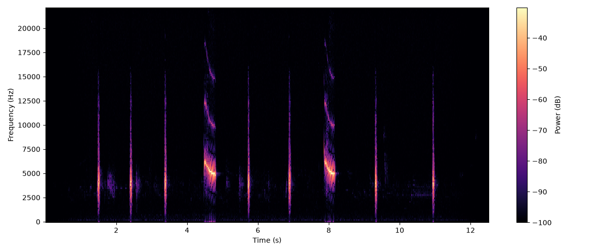
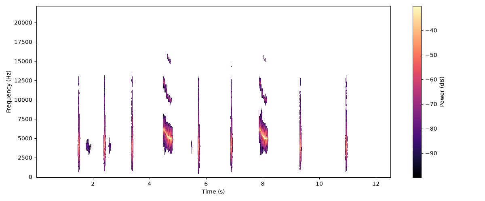
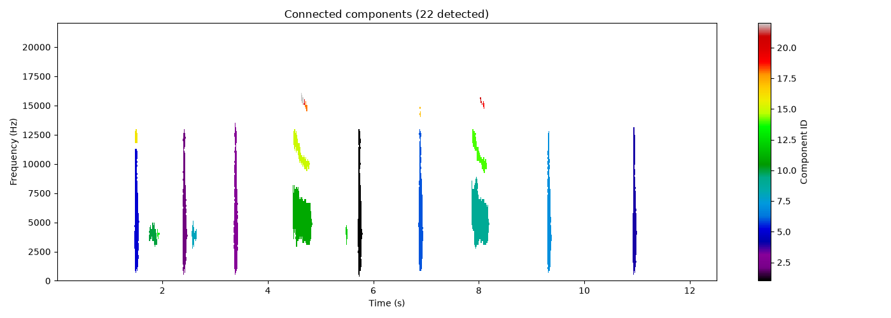

# Oortje - Bird Call Identification Tool

Oortje means little ear in dutch.

I've been an avid user of birding apps like [merlin](https://www.merlinbirds.org/) for years now, and always wondered how they worked at a high level. This repo is a small project exploring that idea a bit more. 

Oortje is a tool that ingests wav recordings of bird calls, and (will in the end) give you a top 3 possibilities of birds you could be listening to (of course depending on the training data you've ingested at that point). Thinking merlin but less effective in almost every way. 

## How it works
Input bird call recordings (`.wav` files) are transforemd to spectrograms, and calls are isolated from background noise using a basic median filtering algorithm. This removes redundant data and allows the use of `scipy.ndimage` labelling to then decompose the calls into individual features. 

Audio recording of a bird call transformed into spectrogram.

Bird call is isolated from background noise features using a median filter. 

Individual features of the bird call are identified.

These features are then used to calculate the `BirdCall` vector, which iterates through each feature to find statistics as needed. This is done for the dataset of all audio recordings of birds, to create all vectors of "known birds" (known as in, in the dataset, not all the birds ever). 

The user can then produce the `BirdCall` vector for their own recording and compare the cosine similarity/euclidean distance of this vector with the dataset to find likely candidates; thereby identifying the bird.

## Usage
For best usage and examples look at test_bed.ipynb. More coming soon

## Data Sources
All the bird recordings I applied for the project were through this [repository](https://dl.allaboutbirds.org/backyardbirdsdownload-0), because I wanted to stay with the Cornell Lab for Ornithology. 

But it's very easy to expand the project with more recordings, this ended up being quite small. If the project ever takes a more complex (deep learning) approach, it might be necessary to expand the dataset using recordings from [xeno-canto](https://xeno-canto.org/) or similar. But for now it's just a hobby...